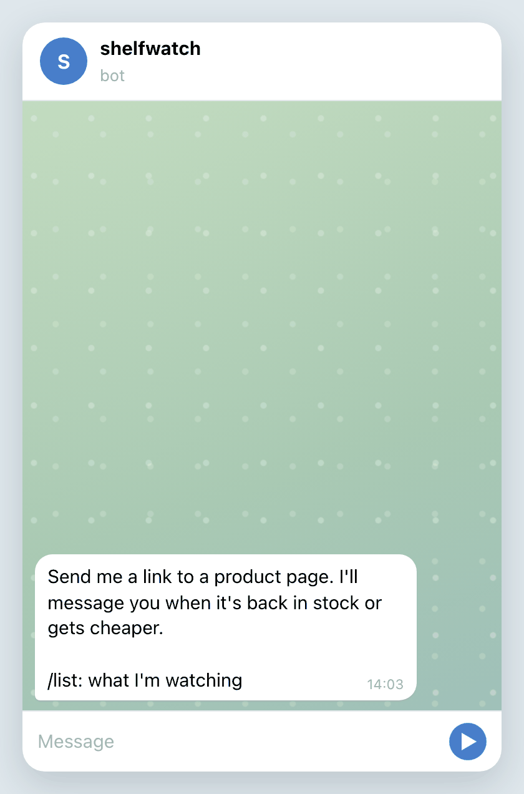

# shelfwatch

[](https://github.com/qweendev/shelfwatch/actions/workflows/ci.yml)


A Telegram bot that tells you when something you're waiting for is back in stock or gets cheaper.
You send it a link and that's it, there's nothing else to set up.

<p align="center"></p>

## What it does

When you send a link, the bot opens the page and shows you the price and stock right away. After that
it checks the page every 15 minutes and writes to you when the item comes back, when the price goes
down, or when it reaches the price you set.

It only opens public addresses, so nobody can use it to reach the server's own network. It waits a few
seconds between requests to the same shop, and if a page keeps failing it checks it less and less often.

## Running it

Create a bot with [@BotFather](https://t.me/BotFather) and copy the token. Then:

```
cp .env.example .env
docker compose up -d
```

Put the token into `.env` before starting. If you'd rather skip Docker, this does the same:

```
uv sync
uv run shelfwatch
```

| variable | default | what it does |
|---|---|---|
| `SHELFWATCH_BOT_TOKEN` | | token from BotFather, required |
| `SHELFWATCH_DATABASE_URL` | `sqlite+aiosqlite:///data/shelfwatch.db` | any async SQLAlchemy URL |
| `SHELFWATCH_CHECK_INTERVAL` | `900` | seconds between checks of one item |
| `SHELFWATCH_PER_HOST_INTERVAL` | `5` | seconds between requests to the same shop |
| `SHELFWATCH_MAX_WATCHES_PER_CHAT` | `25` | how many items one chat can watch |

## Where it works

It works well on shops that publish product data, which is most stores built on Shopify, WooCommerce
or Magento. Big marketplaces usually block bots, and some sites build the whole page with JavaScript,
so the bot can't read those yet. Support for specific marketplaces is next on my list.

## Development

```
uv sync
uv run pytest
uv run ruff check .
uv run mypy src tests
```

## License

MIT, see [LICENSE](LICENSE).
